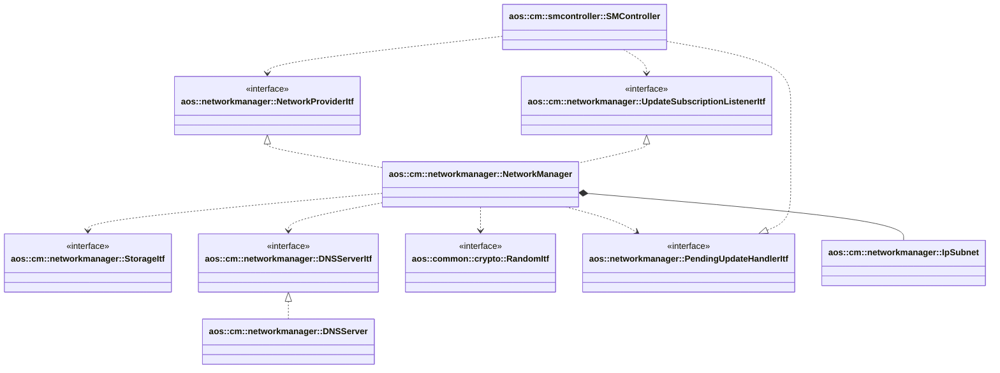
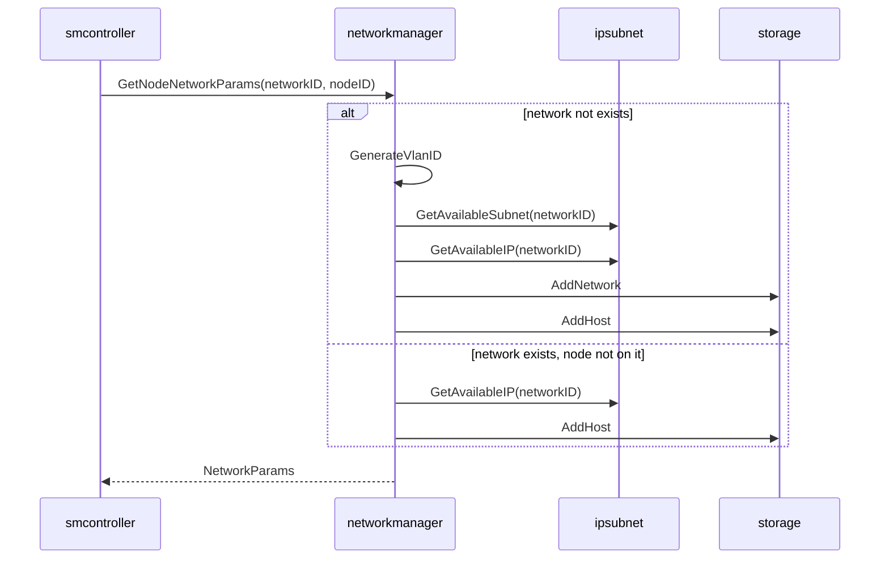
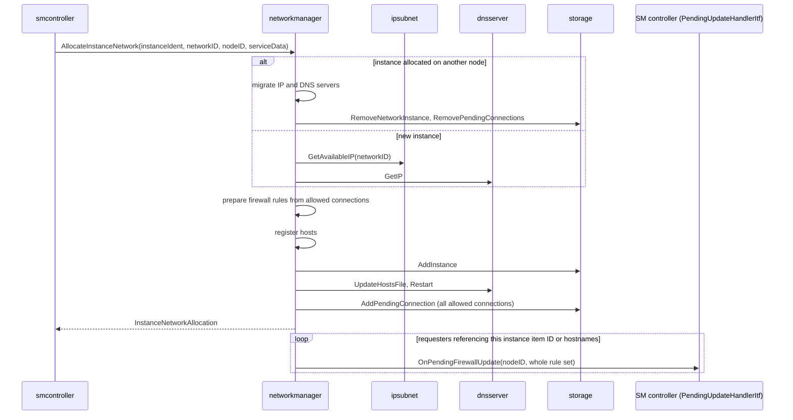
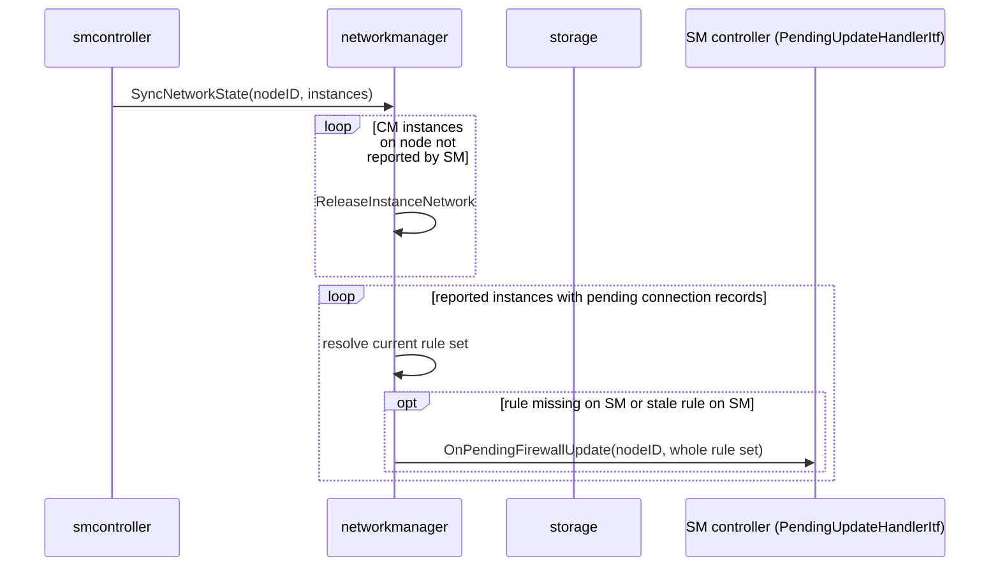
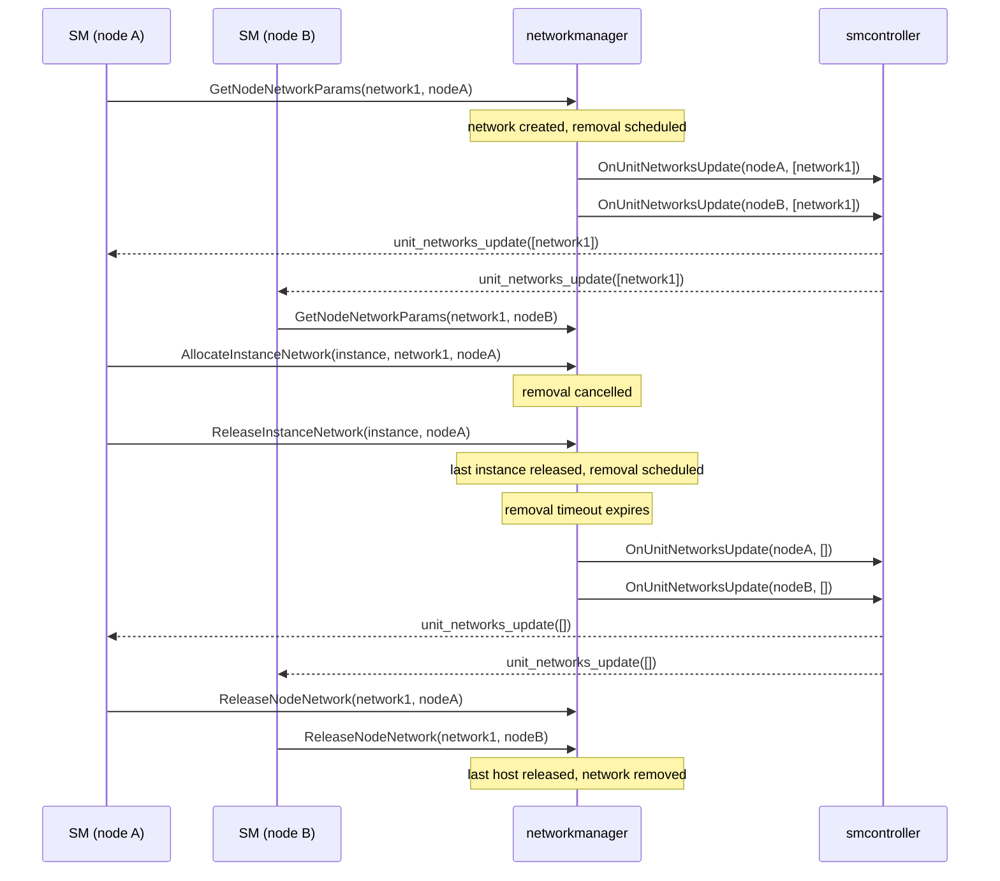

# Network manager

Network manager is the CM side of the AosCore networking. It is the allocator: it hands out subnets, VLAN IDs and IP
addresses to nodes and instances, resolves per-instance firewall rules from allowed connections and exposed ports,
maintains the unit-level DNS hosts, announces the set of unit networks to the nodes and keeps the allocation
consistent across the unit. The node side (namespaces, bridges, firewall, bandwidth, DNS on the node) is built by the
SM network manager.

The overall networking architecture is described in the public documentation:

- [Networking overview][arch-overview];
- [Per-instance network lifecycle][arch-lifecycle].

The contract between SM and CM is described in the core library [common network manager][common-networkmanager].
This document only covers the CM implementation of that contract.

[arch-overview]: https://github.com/aosedge/public-docs/blob/main/docs/aos-core/14-network/index.md
[arch-lifecycle]: https://github.com/aosedge/public-docs/blob/main/docs/aos-core/14-network/per-instance-networking.md
[common-networkmanager]: https://github.com/aosedge/aos_core_lib_cpp/blob/develop/src/core/common/networkmanager/networkmanager.md

It implements the following interfaces:

- [aos::networkmanager::NetworkProviderItf][networkprovider-itf] - serves node/instance network allocation, release
  and state synchronization requests coming from SM. SM controller exposes it to the nodes over the gRPC network
  service;
- [aos::cm::networkmanager::UpdateSubscriptionListenerItf](itf/updatesubscriptionlistener.hpp) - notified by SM
  controller when a node opens or closes the instance network update stream.

It requires the following interfaces:

- [aos::cm::networkmanager::StorageItf](itf/storage.hpp) - persistently stores networks, hosts, instances and pending
  connections;
- [aos::cm::networkmanager::DNSServerItf](itf/dnsserver.hpp) - unit-level DNS server (hosts file update, reload,
  DNS IP);
- [aos::common::crypto::RandomItf][random-itf] - generates VLAN IDs;
- [aos::networkmanager::PendingUpdateHandlerItf][pendingupdatehandler-itf] - optional; receives resolved pending
  firewall rules and the set of unit networks to push them to the node. In CM it is implemented by SM controller.

It uses the following internal components:

- [aos::cm::networkmanager::IpSubnet](ipsubnet.hpp) - subnet and IP allocator over predefined private network pools;
- [aos::cm::networkmanager::DNSServer](dnsserver.hpp) - `DNSServerItf` implementation over a dnsmasq process.

[networkprovider-itf]: https://github.com/aosedge/aos_core_lib_cpp/blob/develop/src/core/common/networkmanager/itf/networkprovider.hpp
[pendingupdatehandler-itf]: https://github.com/aosedge/aos_core_lib_cpp/blob/develop/src/core/common/networkmanager/itf/pendingupdatehandler.hpp
[random-itf]: https://github.com/aosedge/aos_core_lib_cpp/blob/develop/src/core/common/crypto/itf/rand.hpp

## Data model

Network manager keeps its state in memory and mirrors it to the storage:

- **network** (`Network`) - network ID, allocated subnet and VLAN ID. One per network ID in the unit;
- **host** (`Host`) - node ID and the IP allocated to the node on that network (used as the bridge IP on the node). One
  per network and node;
- **instance** (`Instance`) - instance identifier, node ID, network ID, allocated IP, exposed ports, DNS servers and
  the hostnames registered for the instance;
- **pending connection** (`PendingConnection`) - one allowed connection of an instance (requester): requester
  identifier, node, network, IP and subnet, target (item ID or hostname, kept as the original string), port and
  protocol. All allowed connections of an instance are stored, whether or not their target is currently resolvable.
  For compatibility the table is still named `pending_connections` and the column `targetItemID`;
- **hosts** - in-memory map instance IP to DNS names, written to the DNS server hosts file.

In memory the data is organized as network state per network ID: the network, and per node ID the host and its
instances. Besides that, network manager keeps the set of unit networks, the nodes subscribed to the network updates
and the scheduled network removal times (see [Unit networks](#unit-networks)).

## Initialization

`Init` stores the dependencies and:

1. initializes the subnet allocator with the predefined private network pools;
2. loads networks, hosts and instances (with their registered hostnames) from the storage and rebuilds the in-memory
   network states;
3. marks the loaded subnets and IPs as used in the subnet allocator, so they are not allocated again;
4. loads pending connection records from the storage.

`Init` also takes the network remove timeout (`networkRemoveTimeout` in the CM config). A stored network without
instances gets its removal scheduled, so it stays in the set of unit networks for the timeout. The initial set of unit
networks is built from the restored state.

`Start` runs the thread that handles the network removal timeouts and `Stop` stops it; with zero timeout `Start` does
nothing. In the CM application they are called around the SM controller start, so SM controller is stopped first on
shutdown.

Database migration 1 adds an empty hostname list to existing instance records; those lists are populated when SM next
supplies the instance network parameters.

No DNS hosts are rebuilt at this stage: the DNS hosts file is rewritten on the next allocation or release.

## aos::networkmanager::NetworkProviderItf

### GetNodeNetworkParams

Returns node network parameters (network ID, subnet, node IP, VLAN ID) for the given network and node:

- if the network and the node host already exist, returns the stored parameters;
- if the network exists but the node is not on it yet, allocates a node IP from the network subnet and stores the
  host;
- if the network does not exist, generates a unique VLAN ID, allocates a free subnet from the pools, allocates a node
  IP, stores the network and the host and schedules the network removal. The new network is in the set of unit
  networks and is announced to all subscribed nodes before its first instance is allocated.

If the set of unit networks changed, it is pushed to the subscribed nodes (see [Unit networks](#unit-networks)).

### AllocateInstanceNetwork

Allocates instance network for the given instance, network and node. The network and the node host must already exist
(`GetNodeNetworkParams` must be called first), otherwise `eRuntime` is returned.

For a new instance:

1. if the same instance is currently allocated on another node, it is migrated: its IP and DNS servers are reused and
   the record on the other node is removed together with its pending connections;
2. otherwise a free IP is allocated from the network subnet and the CM DNS server IP is set as the instance DNS server;
3. exposed ports and hostnames from the service data are parsed and stored with the instance;
4. firewall rules are prepared from allowed connections (see [Firewall rules](#firewall-rules));
5. the instance hosts are registered in the DNS hosts map. A host name that is already used by another instance
   fails the allocation with `eAlreadyExist`;
6. the instance is stored in the storage and the DNS server is reloaded;
7. all allowed connections are stored as pending connection records;
8. every requester whose records reference this instance's item ID or hostnames is re-resolved and its whole rule set
   is pushed to its node. The instance itself is pushed too if it has already received an update before, so an older
   update still in flight cannot override the allocation result (see
   [Deferred firewall rules](#deferred-firewall-rules)).

For an already allocated instance (repeated call, e.g. SM restarted and re-created the instance), the stored IP and
DNS servers are returned and the firewall rules, hosts, hostnames and pending connection records are recomputed from
the new service data. A renamed hostname updates the rules of requesters that reference the old or the new name.

On any failure the allocated IP, the instance record and the hosts map are rolled back.

A successful allocation cancels the scheduled removal of the network.

### ReleaseInstanceNetwork

Releases the instance on the given node: returns the IP to the subnet, removes the instance hosts from the DNS hosts
map, removes the instance and its pending connection records (where it is the requester) from the storage and reloads
the DNS server. Requesters that reference the released instance's item ID or hostnames are re-resolved and their rule
sets are pushed, so rules to the released address disappear. Unknown instances are ignored. If it was the last
instance on the network, the network removal is scheduled: the network stays in the set of unit networks until the
timeout expires.

### ReleaseNodeNetwork

Releases the node from the network: releases all instances of the node on that network the same way as
`ReleaseInstanceNetwork`, removes the host from the storage and, if it was the last node on the network, returns the
subnet to the pool and removes the network from the storage. The DNS server is reloaded and the requesters referencing
the released instances are updated afterwards. If the node's instances were the last ones on the network but other
nodes remain on it, the network removal is scheduled.

### SyncNetworkState

Reconciles the CM view with the running instances reported by SM on (re)connect:

1. instances that CM has allocated on the node but SM does not report are released (`ReleaseInstanceNetwork`), so the
   set of unit networks is updated the same way;
2. for every reported instance that has pending connection records, the current rule set is resolved and compared
   with the rules reported by SM. If a resolved rule is missing on SM, or SM holds a rule to an address that is no
   longer allocated to any instance, the whole rule set is pushed to the node.

## Unit networks

Network manager owns the set of unit networks. A network is in the set if it has at least one allocated instance on any
node, or if it has no instances but its removal is still pending. Every node creates the bridge and VLAN of every
network of the set (see the [SM network manager][sm-networkmanager]), so instances of different providers on different
nodes can communicate and a network keeps its VLAN ID and subnet while an instance migrates.

[sm-networkmanager]: ../../sm/networkmanager/networkmanager.md

SM stays the initiator of the node network allocation:

- for a network of the set that it does not have, SM calls `GetNodeNetworkParams`;
- for a network that left the set and has no local instances, SM calls `ReleaseNodeNetwork`. CM frees the VLAN ID and
  the subnet of the network when its last host is released.

### Announcing

The full set (network IDs, sorted) is pushed with `PendingUpdateHandlerItf::OnUnitNetworksUpdate(nodeID, networkIDs)`.
SM controller writes it to the node's network update stream as a `unit_networks_update` notification. The set is
pushed:

- to a node when it subscribes to the network update stream, also when the set is empty. SM controller reports it via
  `UpdateSubscriptionListenerItf::OnNodeSubscribed`, and `OnNodeUnsubscribed` when the stream of the node is closed,
  unless a newer stream of the same node has replaced it;
- to all subscribed nodes when the set changes, after `GetNodeNetworkParams`, `AllocateInstanceNetwork`,
  `ReleaseInstanceNetwork`, `ReleaseNodeNetwork`, `SyncNetworkState` and when a removal timeout expires.

Nothing is pushed if the set did not change. If the set does not fit `cMaxNumOwners` IDs, an error is logged and
nothing is pushed: a truncated set is never sent. SM ignores an update that cannot be converted completely.

Pushes are serialized by an update mutex. The handler is never called with the state mutex held.

### Delayed removal

A network without instances stays in the set for the network remove timeout (`networkRemoveTimeout` in the CM config,
`2m` by default, `0` disables the delay). This keeps the VLAN ID and subnet of a network when its only instance is
moved to another node or restarted on update: the instance is released on the old node before it is allocated on the
new one.

The removal is scheduled:

- when the network is created by `GetNodeNetworkParams`;
- when the last instance of the network is released (`ReleaseInstanceNetwork`, `ReleaseNodeNetwork`, stale instances
  in `SyncNetworkState`);
- on `Init` for stored networks without instances.

`GetNodeNetworkParams` for an existing network does not set or extend it. The removal is cancelled when an instance is
allocated in the network. When the timeout expires, the network leaves the set and the new set is pushed. CM does not
delete the network itself: SMs release it and CM removes it with its last host. The removal time is kept in memory
only, so after a CM restart the full timeout starts again.

## Firewall rules

Allowed connections are given in the service data as `<target>/<port>[/<protocol>]` (protocol defaults to `tcp`, port
may be a range in the `first:last` form). Exposed ports are given as `<port>[/<protocol>]`.

The target is an item ID or a hostname registered for an instance in the service data hosts (the configured service
hostname or a generated instance DNS name). Matching is exact against the CM instance registry, without external DNS
resolution. Item IDs are searched first; hostnames are searched only when no item ID matches, and a matching item ID
keeps precedence even if it does not expose the requested ports. Hostnames are globally unique, as enforced during
allocation. For example, both `service-id/8080:8082/tcp` and `hostname-service/8080:8082/tcp` are supported.

For each allowed connection network manager looks up the allocated instances of the target:

- if the target instance is in the same subnet as the requester, no rule is needed: instances on the same network
  communicate without restrictions;
- if the target instance exposes at least one requested port with the matching protocol, only the exposed requested
  ports are allowed: a `FirewallRule` (destination IP and port, protocol, source IP) is added for each contiguous range
  of them, e.g. `8080:8084` with exposed `8080`, `8082` and `8083` gives the rules `8080` and `8082:8083`;
- otherwise no rule is added for this connection.

Requested ports the target does not expose are skipped with a warning logged when the requester network is allocated
(on pushed updates the same message is logged at debug level, so re-resolving does not repeat the warning). No warning
is logged while the target is not allocated yet or when it is in the requester's subnet.

A rule set is limited to `cMaxNumFirewallRules` rules. Rules are taken in the order of the allowed connections; the
rest are dropped with a warning, identically on allocation and on pushed updates.

## Deferred firewall rules

All allowed connections of an instance are kept as pending connection records, in memory (keyed by requester) and in
the storage, until the requester is released, migrated to another node or allocated again.

When a target instance is allocated, re-allocated, renamed or released, CM re-resolves every requester whose records
reference the target's item ID or hostnames, builds the requester's whole current rule set into a
`PendingFirewallUpdate` and pushes it via `PendingUpdateHandlerItf` to the node where the requester runs. SM controller
forwards the update to the node over the network update stream. The receiver replaces the rules it holds, so rules to
a released or re-addressed target are removed and rules to its new address are added.

A requester that has already received such an update also gets its rule set pushed after its own re-allocation, so an
older update still in flight cannot override the allocation result. Updates lost while the node was offline are
recovered on `SyncNetworkState`: CM pushes the rule set again to any reported requester that lacks a resolved rule or
holds a rule to an address no longer allocated to any instance.

## Network pools

Subnets are allocated from the predefined private pools defined in
[common/network/netpools.hpp](../../common/network/netpools.hpp), shared with the SM firewall which uses them to
recognize AosCore networks on other nodes: base networks `172.17.0.0/16`, `172.18.0.0/16`, `172.19.0.0/16`,
`172.20.0.0/14`, `172.24.0.0/14` and `172.28.0.0/14` are split into `/16` subnets by [netpool.cpp](netpool.cpp).
When a subnet is requested for a new network, the allocator takes the first pool subnet that does not overlap with any
route on the CM host. The node and instance IPs are taken sequentially from the subnet.

## aos::cm::networkmanager::IpSubnet

- `Init` - loads the predefined pools;
- `GetAvailableSubnet(networkID)` - returns the subnet of the network, allocating a free one on the first call;
- `GetAvailableIP(networkID)` - returns the next free IP of the network subnet;
- `ReleaseIPToSubnet(networkID, ip)` - returns the IP back to the network subnet;
- `ReleaseIPNetPool(networkID)` - returns the network subnet back to the pools;
- `RemoveAllocatedSubnet(networkID, subnet, IPs)` - marks a subnet and its IPs loaded from the storage as used.

## aos::cm::networkmanager::DNSServerItf

CM runs a single unit-level dnsmasq that serves instance host names to all nodes. Network manager keeps the instance
IP to names map and writes it to the dnsmasq additional hosts file.

- `UpdateHostsFile(hosts)` - rewrites the `addnhosts` file in the DNS storage directory with the IP to names mapping;
- `Restart` - reads the dnsmasq PID from the PID file and sends `SIGHUP`, so dnsmasq reloads the hosts file without
  restarting;
- `GetIP` - returns the DNS server IP, which is handed to instances as their DNS server.

The DNS storage path, PID file and IP are taken from the CM config.
