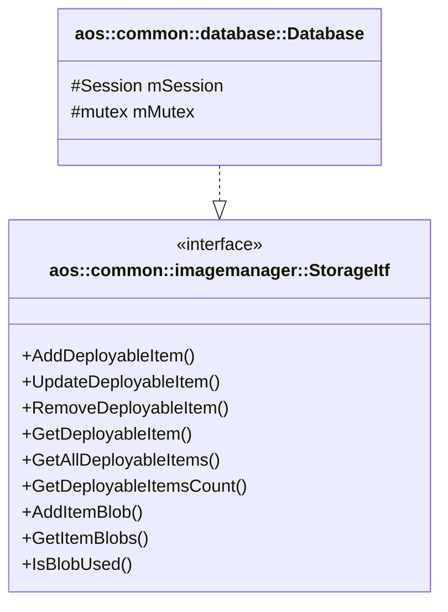

# Common Database Module

## Overview

The common `aos::common::database::Database` class provides SQLite based implementation of storage interfaces shared
between Aos applications. It is a base class: the application database (e.g. CM
[Database](../../cm/database/database.md)) inherits it, opens the database session in its own `Init` and uses the
protected `mSession` and `mMutex` members for its own tables.

The `Database` class implements the following interfaces:

- [aos::common::imagemanager::StorageItf][imagemanager-storage-itf] - image manager interface.

The class doesn't create tables. Tables described below must be created by the application database migration scripts.

## Class Diagram

## Database Schema

### Tables

#### `imagemanager_items`

Stores image manager deployable items.

| Column       | Type    | Description                          |
|--------------|---------|--------------------------------------|
| itemID       | TEXT    | Item identifier                      |
| type         | TEXT    | Item type (service/component)        |
| version      | TEXT    | Item version                         |
| preinstalled | INTEGER | Preinstalled item indicator (0/1)    |
| state        | TEXT    | Item state                           |
| errorAosCode | INTEGER | Item error: AOS error code           |
| errorSysCode | INTEGER | Item error: system error code        |
| errorMessage | TEXT    | Item error: message                  |
| rootDigest   | TEXT    | Digest of the item root manifest     |
| timestamp    | INTEGER | Timestamp in nanoseconds             |

**Primary Key**: `(itemID, version)`

#### `imagemanager_blobs`

Stores blobs referenced by deployable items. Rows are removed together with the item. A blob is considered used only if
it is referenced by an existing item in `imagemanager_items`.

| Column    | Type    | Description                     |
|-----------|---------|---------------------------------|
| itemID    | TEXT    | Item identifier                 |
| version   | TEXT    | Item version                    |
| digest    | TEXT    | Blob digest                     |
| mediaType | TEXT    | Blob media type                 |
| size      | INTEGER | Blob size in bytes              |
| isLayer   | INTEGER | Layer blob indicator (0/1)      |
| diffID    | TEXT    | Layer diff ID                   |

**Primary Key**: `(itemID, version, digest)`

**Index**: `imagemanager_blobs_digest` on `(digest)`

## Dependencies

- Poco::Data — database abstraction layer;
- SQLite — database backend;
- AOS Core — common types, utilities, and interfaces.

[imagemanager-storage-itf]: https://github.com/aosedge/aos_core_lib_cpp/blob/main/src/core/common/imagemanager/itf/storage.hpp
