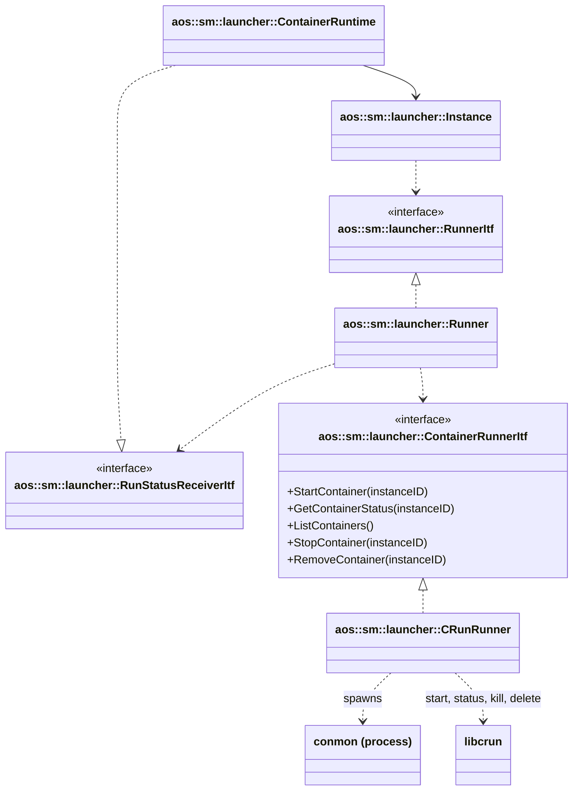
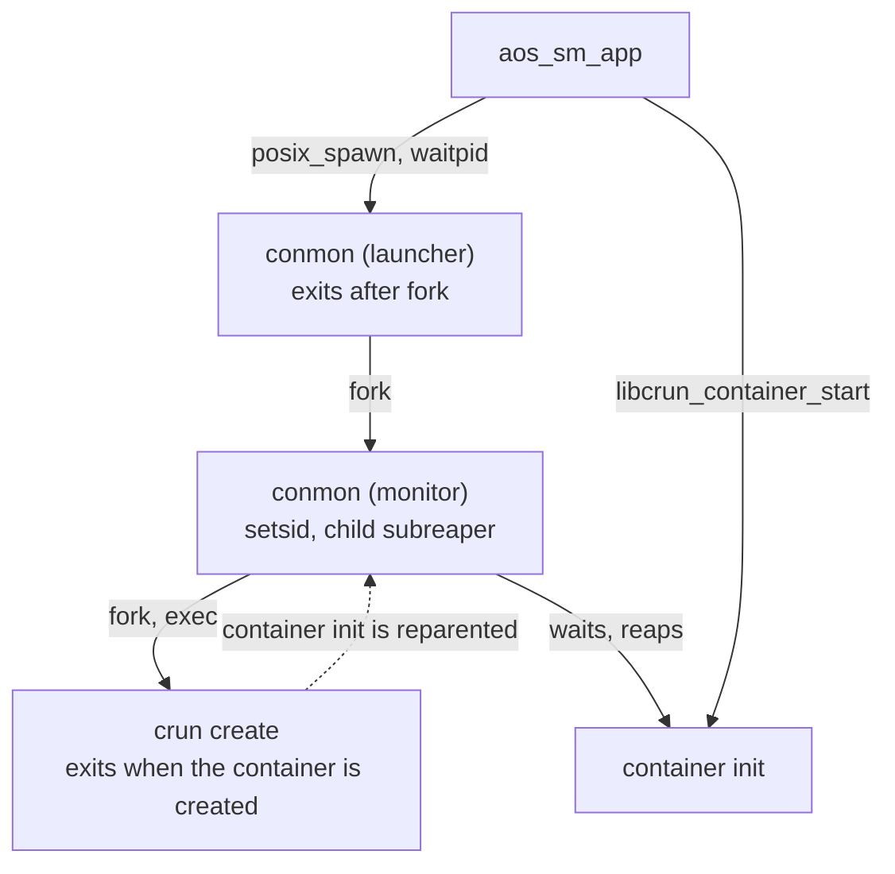
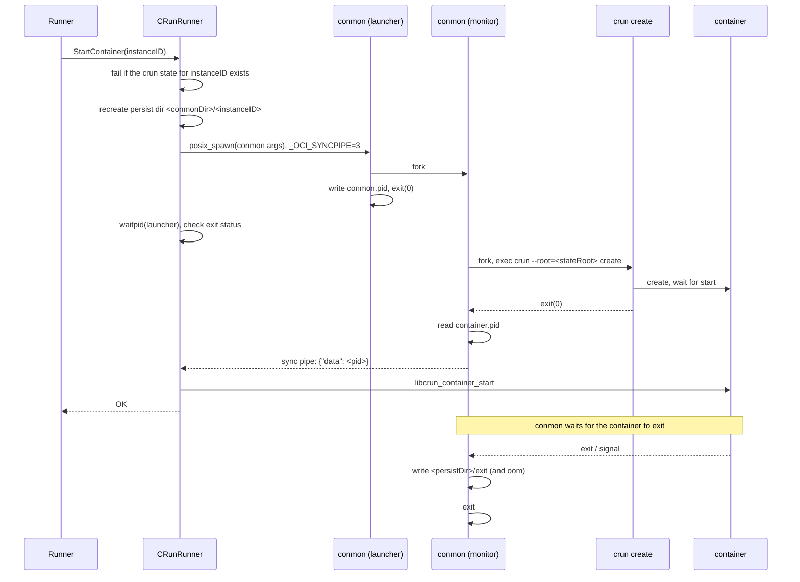

# Container monitoring with conmon

The container runtime launches crun containers through [conmon][conmon], the OCI container monitor used by podman and
CRI-O. conmon stays alive next to each container for its whole lifetime and records how the container finished: its
exit code and whether it was killed by the OOM killer. SM reads this record to report the instance state and the
reason of a failure.

Previously containers were started with a detached `crun run -d`. In that case the container process is reparented to
init as soon as crun exits, so SM is not its parent, can't `waitpid()` it and has no way to learn the exit code. conmon
fills this gap: it makes itself a child subreaper, so the container is reparented to conmon instead, and conmon reaps
it and persists the result.

[conmon]: https://github.com/containers/conmon

## Components

- [aos::sm::launcher::ContainerRuntime](container.hpp) - the container runtime. Creates the runner and the container
  runner from the [runtime config](config.hpp).
- [aos::sm::launcher::Runner](runner.hpp) - [RunnerItf](itf/runner.hpp) implementation. Tracks the started instances,
  polls their state, reports state changes and restarts failed containers according to the instance run parameters.
- [aos::sm::launcher::CRunRunner](crunrunner.hpp) - [ContainerRunnerItf](itf/containerrunner.hpp) implementation. Starts
  containers through conmon and crun, reads their state from the crun state root and the conmon persist dir, stops and
  removes them with libcrun ([libcrun.hpp](libcrun.hpp)).

## Process model

`CRunRunner` spawns conmon, which double-forks: the process SM spawned exits right away, and the monitor keeps running
detached from SM in its own session. The monitor forks `crun create`, which creates the container and exits, leaving
the container init process to the monitor, which is a child subreaper.

Because the monitor is not a child of SM, it survives SM exit and keeps watching the container, and SM doesn't have to
reap it. conmon only implements creating a container: starting it is the caller's job, as it is for podman and CRI-O.
SM starts the container in-process with `libcrun_container_start()` once conmon has reported that it's created.

## Starting a container

If anything fails after conmon is spawned, `StartContainer` calls `RemoveContainer` to clean up whatever was created
and returns the error. It refuses to touch an instance whose crun state already exists, so the cleanup can never
destroy a running container.

### conmon invocation

| Argument                                         | Purpose                                                        |
| ------------------------------------------------ | -------------------------------------------------------------- |
| `--api-version`                                  | Use the current sync pipe protocol (`{"data": ...}` messages). |
| `--cid <instanceID>`, `--cuuid <instanceID>`     | Container ID passed to crun, and the ID conmon logs with.      |
| `--runtime <crunExecutable>`                     | OCI runtime to run.                                            |
| `--runtime-arg=--root=<crunStateRoot>`           | crun global args, placed before `create`.                      |
| `--bundle <runtimeDir>/<instanceID>`             | OCI bundle prepared by the instance.                           |
| `--container-pidfile <persistDir>/container.pid` | Where crun writes the container init pid.                      |
| `--conmon-pidfile <persistDir>/conmon.pid`       | Where conmon writes the monitor pid.                           |
| `--persist-dir <persistDir>`                     | Where conmon writes the `exit` and `oom` files.                |
| `--log-path passthrough`                         | Container uses SM's stdout/stderr, see [Logging](#logging).    |
| `--syslog`                                       | conmon's own messages go to syslog, tagged `conmon`.           |

conmon gets SM's environment, except `NOTIFY_SOCKET` (crun would take it as the container's notify socket) and any
stale `_OCI_*` variables, plus `_OCI_SYNCPIPE`.

### Sync pipe

conmon reports the result of creating the container on the file descriptor given in `_OCI_SYNCPIPE`. `CRunRunner`
creates a pipe and places its write end at fd 3 in the spawned process, so the monitor inherits it:

- `{"data": <pid>}` - the container is created, `<pid>` is its init process;
- `{"data": -1, "message": "<runtime stderr>"}` - `crun create` failed;
- EOF without a message - conmon exited before reporting anything.

`CRunRunner` reads the first line with a 30 seconds timeout. With the passthrough log driver crun's stderr goes
straight to SM's stderr instead of conmon, so a failing `crun create` usually ends in EOF and the
`container creation failed, see conmon log for details` error. The actual reason is then in the SM journal (crun's
stderr), in syslog under the `conmon` tag, or in the audit log for SELinux denials.

## Persist dir

Each instance gets its own directory `<conmonDir>/<instanceID>`, separate from the crun state root: crun requires its
state root to contain only what crun created.

| File            | Written by | Content                                                                    |
| --------------- | ---------- | -------------------------------------------------------------------------- |
| `conmon.pid`    | conmon     | pid of the conmon monitor.                                                 |
| `container.pid` | crun       | pid of the container init process.                                         |
| `exit`          | conmon     | Container exit code: the exit status, or `128 + signal` if it was killed.  |
| `oom`           | conmon     | Empty marker, present if the container was killed by the OOM killer.      |

The directory is recreated before every start, so a stale `exit` or `oom` file can't be attributed to a new run, and
removed by `RemoveContainer`.

## Monitoring

`Runner` polls the state of all containers once per second through `ListContainers()`. It lists the crun state root,
so containers started by a previous SM instance are seen too.

`CRunRunner` builds the status of a container from two sources:

1. crun state: the container is `active` while crun reports it running, `failed` otherwise, including when crun has
   no state for it;
2. persist dir: for a container that isn't running, the `exit` file gives `ContainerStatus::mExitCode` and the `oom`
   file sets `ContainerStatus::mOOMKilled`. The exit code stays empty until conmon has reaped the container, or if
   conmon itself is gone.

`Runner` turns this into the instance run error, which is reported to CM as part of the instance status:

| Container status                         | Run error                          |
| ---------------------------------------- | ---------------------------------- |
| active                                   | none                               |
| failed, `oom` present                    | `container killed by OOM`          |
| failed, exit code `N != 0`               | `container exited with code N`     |
| failed, exit code `0` or no exit file    | none (the state is still `failed`) |

A state or error change triggers a run status update. A failed container is then restarted according to the
instance run parameters (restart interval, start interval and start burst), see [runner.cpp](runner.cpp). Restarting
removes the container and its persist dir, so the exit code of the previous run is reported only until the restart.

## Stopping and removing

- `StopContainer` sends `SIGKILL` to the container with `libcrun_container_kill()`. conmon reaps it and writes `exit`
  (`137`).
- `RemoveContainer` force-deletes the crun state with `libcrun_container_delete()`, then waits for the conmon monitor to
  exit before removing the persist dir. Otherwise a conmon still finishing up could write the `exit` file of the old
  container into the persist dir of the next run of the same instance. The wait polls `/proc/<pid>/cmdline` of the pid
  from `conmon.pid` every 50 ms, and kills conmon with `SIGKILL` if it hasn't exited within 5 seconds. A process only
  counts as this instance's conmon if it was started with this instance's `--conmon-pidfile`, so a reused pid, even
  one taken by the conmon of another instance, is never waited for or killed.

## Logging

conmon runs with the `passthrough` log driver: the container inherits conmon's stdin/stdout/stderr, which are SM's, so
container output goes to the SM journal as it did with `crun run -d`. conmon doesn't copy the output and doesn't create
attach sockets or log files.

## Configuration

Keys of the container runtime `config` object in the SM config:

| Key                | Default            | Description                                                         |
| ------------------ | ------------------ | ------------------------------------------------------------------- |
| `crunExecutable`   | `/usr/bin/crun`    | crun binary run by conmon.                                          |
| `crunStateRoot`    | `/run/crun`        | crun state root (`--root`). Must be used by SM only.                |
| `conmonExecutable` | `/usr/bin/conmon`  | conmon binary.                                                      |
| `conmonDir`        | `/run/aos/conmon`  | Base directory of the per-instance persist dirs.                    |
| `runtimeDir`       | `/run/aos/runtime` | Base directory of the OCI bundles (`<runtimeDir>/<instanceID>`).    |

## Build and installation

conmon is built by the conan recipe [conan/conmon-2.1.13.py](../../../../../conan/conmon-2.1.13.py) from its plain
Makefile, with glib linked statically, so the binary only depends on libc. seccomp notify and journald support are
disabled: they're not needed with the passthrough log driver. With `WITH_AOS_INSTALL`, the binary is installed into
`bin` next to crun (see [src/sm/app/CMakeLists.txt](../../../app/CMakeLists.txt)).

## Limitations

- **SM restart** - conmon runs in the `aos-sm.service` cgroup, so systemd kills it when SM stops (`KillMode` is
  `control-group`). The containers keep running and SM re-attaches to them, but their exit code is no longer recorded:
  their status still comes from crun, with no exit code.
- **SELinux** - `crun create` creates the `exec.fifo` FIFO in the crun state root, which `crun run` never did. The
  SELinux policy must allow the crun domain (`container_engine_t`) to create FIFOs there.
- **Creation errors** - with the passthrough log driver crun's stderr isn't captured, so creation failures are
  reported with a generic error, see [Sync pipe](#sync-pipe).
- **Run error changes** - two run errors of the same type compare as equal, so a container that fails again with a
  different exit code, without becoming active in between, isn't reported again.
