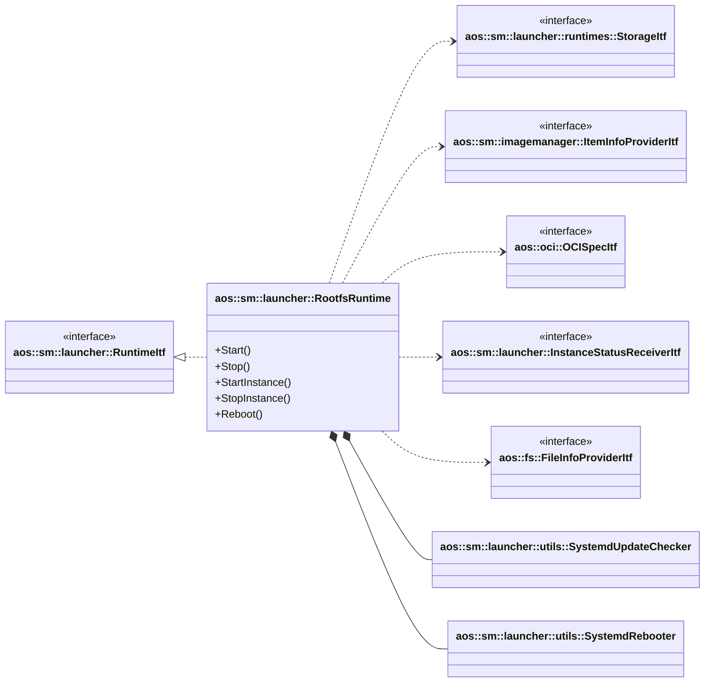
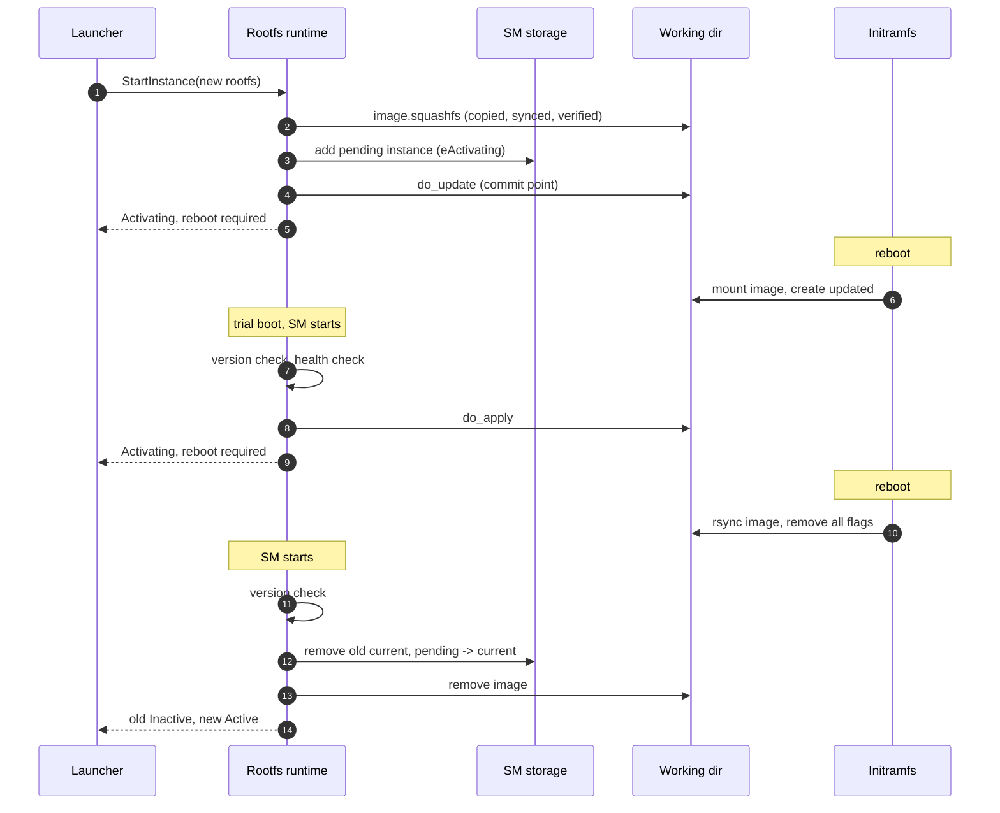
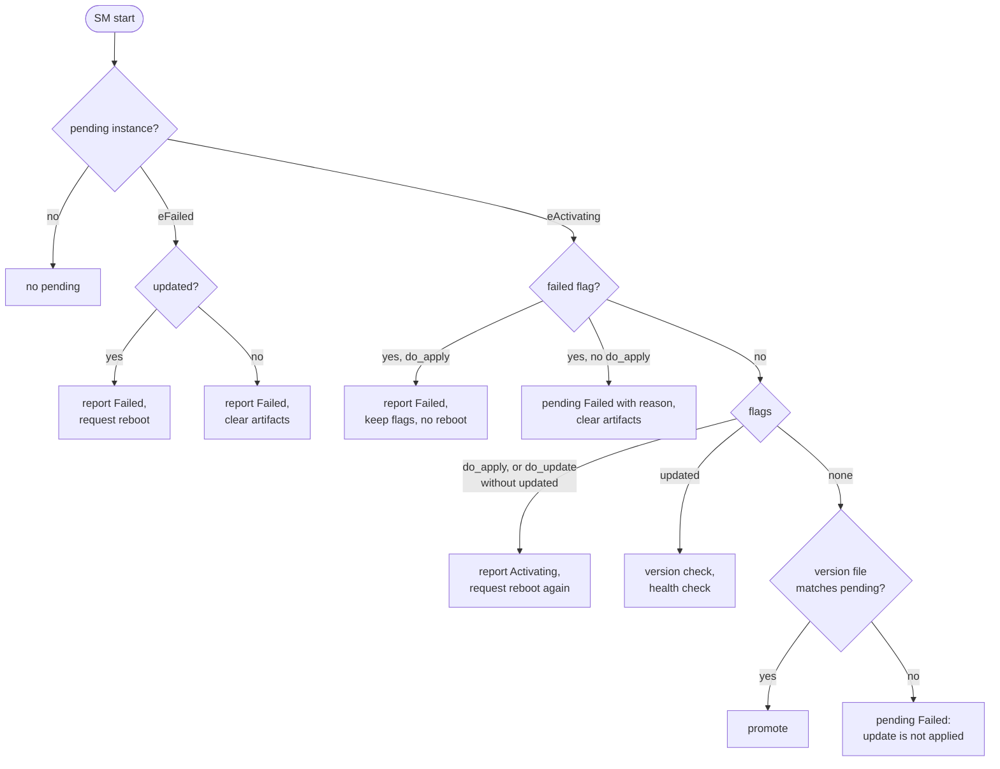

# Rootfs runtime

The rootfs runtime updates the node root filesystem. It is a component runtime with a single instance: the instance
represents the rootfs version that is currently running on the node. Starting a new instance means updating the rootfs.

The update itself is done by the initramfs [aosupdate][aosupdate] module on boot. The module is kept as simple as
possible: it only acts on the update flags and has no recovery logic. The runtime prepares the update, requests
reboots, confirms the updated rootfs with a health check, reports instance statuses and handles all recovery.

The update is split between two stores:

- **SM storage** is the source of truth for **which instances exist** and their last reported state and error;
- **update flags** in the working directory are shared with the initramfs and define **what initramfs does on boot**.

On start, SM reconciles both stores with the running rootfs version and continues the update. The update must survive
power loss and SM restarts at any moment. The main rules are:

- a not applied update is never reported as installed;
- a failed update is never applied or promoted;
- every step is either atomic or repeatable, and is durable before the next step depends on it;
- storage and flags are changed in a fixed order, so no transactions are needed.

[aosupdate]: https://github.com/aosedge/meta-aos/blob/develop/recipes-core/initrdscripts/initramfs-framework/aosupdate

## Overview

[RootfsRuntime](rootfs.hpp) implements [aos::sm::launcher::RuntimeItf][runtime-itf] and uses:

- [aos::sm::launcher::runtimes::StorageItf](../itf/storage.hpp) - stores the current and the pending instances;
- [aos::sm::imagemanager::ItemInfoProviderItf][item-info-provider-itf] - provides paths of the installed image blobs;
- [aos::oci::OCISpecItf][oci-spec-itf] - loads the image manifest;
- [aos::sm::launcher::InstanceStatusReceiverItf][status-receiver-itf] - receives instance statuses and reboot requests;
- [aos::iamclient::CurrentNodeInfoProviderItf][node-info-provider-itf] - provides node info for the runtime info and the
  default instance ident;
- [aos::fs::FileInfoProviderItf][file-info-provider-itf] - calculates the size and the checksum of the copied image;
- [SystemdUpdateChecker](../utils/systemdupdatechecker.hpp) - checks that the configured systemd units are active after
  the update;
- [SystemdRebooter](../utils/systemdrebooter.hpp) - reboots the node through systemd.

[runtime-itf]: https://github.com/aosedge/aos_core_lib_cpp/blob/develop/src/core/sm/launcher/itf/runtime.hpp
[item-info-provider-itf]: https://github.com/aosedge/aos_core_lib_cpp/blob/develop/src/core/sm/imagemanager/itf/iteminfoprovider.hpp
[oci-spec-itf]: https://github.com/aosedge/aos_core_lib_cpp/blob/develop/src/core/common/ocispec/itf/ocispec.hpp
[status-receiver-itf]: https://github.com/aosedge/aos_core_lib_cpp/blob/develop/src/core/sm/launcher/itf/instancestatusreceiver.hpp
[node-info-provider-itf]: https://github.com/aosedge/aos_core_lib_cpp/blob/develop/src/core/common/iamclient/itf/currentnodeinfoprovider.hpp
[file-info-provider-itf]: https://github.com/aosedge/aos_core_lib_cpp/blob/develop/src/core/common/tools/fs.hpp



`StopInstance` only reports the instance as inactive: the rootfs can't be stopped. `InitInstances` does nothing and
`GetInstanceMonitoringData` is not supported.

## Configuration

The runtime is configured in the SM `runtimes` section:

```json
{
    "plugin": "rootfs",
    "type": "rootfs",
    "isComponent": true,
    "config": {
        "workingDir": "/var/aos/workdirs/sm/runtimes/rootfs",
        "versionFilePath": "/etc/aos/version",
        "healthCheckServices": ["aos-cm.service", "aos-sm.service", "aos-iam.service"]
    }
}
```

| Parameter             | Default                            | Description                                         |
| --------------------- | ---------------------------------- | --------------------------------------------------- |
| `workingDir`          | `<SM working dir>/runtimes/rootfs` | Update artifacts directory shared with initramfs.   |
| `versionFilePath`     | `/etc/aos/version`                 | Rootfs version file, format: `VERSION="<version>"`. |
| `healthCheckServices` | empty                              | systemd units that must be active after the update. |

`workingDir` must be the directory that the initramfs uses as the update directory (`aosupdate.disk` and
`aosupdate.path` kernel parameters).

## Data

| Data                                                                            | Where            | Written by    |
| ------------------------------------------------------------------------------- | ---------------- | ------------- |
| Current instance: ident, manifestDigest, version, preinstalled, state `eActive` | SM storage       | SM            |
| Pending instance: ident, manifestDigest, version, state, error                  | SM storage       | SM            |
| Update flags: `do_update`, `updated`, `do_apply`, `failed`                      | working dir      | SM, initramfs |
| Update image                                                                    | `image.squashfs` | SM            |

### Instances

The runtime instances are stored in the SM storage `runtimeInstances` table, keyed by runtime ID, instance ident
(except the preinstalled flag) and version:

- **current instance** - the installed rootfs, state `eActive`. If it doesn't exist or doesn't match the version file
  of the installed rootfs, it is created from the version file with the default ident: item ID is the runtime type,
  subject ID is the node type, the instance is preinstalled;
- **pending instance** - the update, state `eActivating` while in progress and `eFailed` with the error after
  failure. The failed pending instance is kept in storage, so the failure is reported after SM restart, until a new
  update replaces it.

The rootfs version file of the update image must contain the version of the update item. The version is used to check
that the node really runs the updated rootfs.

### Update flags

| Flag        | Written by | Content        | Meaning                                                       |
| ----------- | ---------- | -------------- | ------------------------------------------------------------- |
| `do_update` | SM         | update type    | Update image is ready: mount it as rootfs (trial boot).       |
| `updated`   | initramfs  | empty          | Update image is mounted as rootfs.                            |
| `do_apply`  | SM         | empty          | Trial boot is confirmed by the health check: apply the image. |
| `failed`    | initramfs  | failure reason | Initramfs failed to mount, apply or revert the update.        |

The update type is `full` or `incremental`. SM writes flags atomically: `<flag>.tmp` is written, synced and renamed,
then the working directory is synced. The temporary file extension doesn't match the initramfs image search pattern.

## Initramfs

On boot, initramfs selects a single action by the flags:

| Flags       | Action                                                                    |
| ----------- | ------------------------------------------------------------------------- |
| `do_apply`  | rsync the image into the rootfs, remount read-only, remove all flags      |
| `updated`   | revert: remove all flags, write `failed` with `update not confirmed`      |
| `do_update` | mount the image (full: as rootfs, incremental: overlay), create `updated` |
| none        | no action                                                                 |

On error initramfs writes `failed` with the reason and keeps the other flags, so a failed apply is retried on next
boot. Trial never modifies the installed rootfs, so a revert only removes the flags. Initramfs doesn't verify the
image, it relies on the verification done by SM.

## Update flow

1. SM storage stores the current rootfs instance: itemId, subjectId, instance, manifestDigest, version, preinstalled,
   state `eActive`.
2. On update (`StartInstance` for a new instance):
   1. the running health check is joined, update artifacts are cleared (flags first) and the previous pending instance
      is removed from storage;
   2. the image is copied with `std::filesystem::copy_file` to `image.squashfs.tmp`, synced, verified (size and sha256
      through `FileInfoProviderItf`) and renamed to `image.squashfs`;
   3. SM storage adds the pending instance with state `eActivating`;
   4. `do_update` is written with the update type. This is the **commit point**: before it, initramfs does nothing;
   5. reboot is requested.
3. Initramfs mounts the image and creates `updated` (trial boot).
4. SM starts in trial boot (`updated`):
   1. the version file must match the pending version, otherwise the pending instance is failed with
      `rootfs version mismatch` and reboot is requested;
   2. health check OK: `do_apply` is written, reboot is requested. The pending instance stays `eActivating`;
   3. health check failed or `do_apply` can't be written: the pending instance is failed with the error, reboot is
      requested. Initramfs reverts the update on next boot.
5. Initramfs applies the image and removes all flags.
6. SM starts without flags and the version file matches the pending version:
   1. the old current instance is removed from storage, then the pending instance becomes current (`eActive`);
   2. the image is removed;
   3. the old instance is reported as `eInactive` and the new one as `eActive`.



### Start instance

`StartInstance` returns the known status without any action if the instance is the current or the pending one:

- if the pending instance is failed, the update error is returned as well: the launcher treats a successful start as an
  active instance. The failed update is not retried until a new update replaces it;
- if a reboot is still required, the reboot request is sent again. The launcher skips duplicated requests.

Otherwise, the update is prepared (step 2). A new update is accepted at any update step: the flags of the previous
update are removed first, so initramfs doesn't act on them anymore. The media type of the first image layer defines
the update type: `[application/]vnd.aos.image.component.<full|inc>.v<N>[+<suffix>]`.

If any preparation step fails, artifacts and the pending instance are removed and the instance is reported as failed.
If only the reboot request fails, the prepared update is kept, the error is returned and the request is sent again on
the next `StartInstance` for this instance.

### Health check

The health check waits until all configured systemd units are active or any of them failed, with retries (5 attempts,
10 seconds to 1 minute delay). It is started after `Start` sends its statuses, so the health check result is always
received after them. An SM restart before the verdict is stored runs the health check again.

If the pending update is replaced before the verdict is stored, the verdict is discarded.

## Start processing

On start, SM loads the current and pending instances from storage and the update flags, and reconciles them. Storage
and flag lookup errors are returned as errors and are never treated as missing data: a wrong decision may cancel the
update that is being applied.



| Pending instance | Flags                   | Action                                                           |
| ---------------- | ----------------------- | ---------------------------------------------------------------- |
| none             | `do_apply`              | Keep flags: initramfs completes the apply, report current.       |
| none             | `updated`               | Clear artifacts, request reboot. Report current.                 |
| none             | other or none           | Clear artifacts, report current (default on version mismatch).   |
| `eFailed`        | `updated`, no `failed`  | Trial rootfs is running: report the failure, request reboot.     |
| `eFailed`        | other or none           | Clear artifacts, report the failure: it survives SM restarts.    |
| `eActivating`    | `failed` and `do_apply` | Apply failed: report `eFailed` (not stored), keep flags.         |
| `eActivating`    | `failed`, no `do_apply` | Pending `eFailed` with the reason, clear artifacts.              |
| `eActivating`    | `do_apply`              | SM restarted before reboot: request reboot again.                |
| `eActivating`    | only `do_update`        | SM restarted before reboot: request reboot again.                |
| `eActivating`    | `updated`               | Version check and health check (step 4).                         |
| `eActivating`    | none, pending version   | Promote (step 6).                                                |
| `eActivating`    | none, other version     | Pending `eFailed` with `update is not applied`, clear artifacts. |

An apply failure is not stored: the rootfs may be partially updated, and initramfs retries the apply on every boot.
SM doesn't request reboot in this case to avoid a reboot loop. When the retried apply succeeds, the update is promoted.

Without flags, the version file tells whether initramfs applied the update. The update didn't happen if SM was
interrupted before `do_update` was written, or if initramfs was interrupted during the revert before `failed` was
written. An update with the same version as the current one is promoted in both cases.

## Power loss scenarios

| Interrupted at                | State after                      | Result                                          |
| ----------------------------- | -------------------------------- | ----------------------------------------------- |
| 2.2 image copy                | temporary image only             | Temporary image removed, nothing happened.      |
| after 2.3, before 2.4         | pending `eActivating`, no flags  | Pending `eFailed`, image removed.               |
| after 2.4, before reboot      | `do_update`                      | SM restart: reboot requested again.             |
| 3 before `updated` is created | `do_update`                      | Next boot repeats the mount.                    |
| after 3, before SM verdict    | `do_update`, `updated`           | Next boot: initramfs reverts, update failed.    |
| 4.2 `do_apply` write          | `updated` or `do_apply`          | Revert or apply, both consistent.               |
| 4.3 before pending `eFailed`  | `updated`, pending `eActivating` | SM restart: health check repeated.              |
| revert, before `failed`       | no flags, installed rootfs       | Pending `eFailed` with `update is not applied`. |
| 5 during rsync                | `do_apply`                       | Next boot repeats the apply.                    |
| 5 after rsync, before cleanup | `do_apply`                       | Apply repeated, rsync is idempotent.            |
| 6.1 between storage writes    | pending only in storage          | Promotion repeated on next start.               |
| 6.2 image removal             | stale image                      | Image removed on next start.                    |

## Durability

1. **Storage write is durable before the flag is written** (2.3 → 2.4). For SQLite this requires `synchronous=FULL`:
   in WAL mode `synchronous=NORMAL` may lose the last commit on power loss, which leaves `do_update` without the
   pending instance.
2. **Storage writes are ordered instead of transactions**:
   - promotion removes the old current instance first, then updates the pending one. If interrupted, only the pending
     instance is left and the promotion is repeated;
   - the default current instance replaces the old one in the same order. If interrupted, there is no current
     instance and the default one is created on next start.
3. **Storage and working directory are located on the persistent data partition**, not on the rootfs. During trial
   boot the rootfs is the update image or an overlay: storage on the rootfs is lost on revert or taken from the image.
4. **Ordering rule**: on update, *image and storage first, `do_update` last* (the flag is the commit point); on
   cleanup, *flags first, then image* (initramfs stops acting first).
5. **The image is never removed while `do_update` or `do_apply` exists**: initramfs fails the update without the image.

Artifacts are cleared in two steps:

1. flags are removed (`do_apply` first) and the working directory is synced. Cleanup stops if this step fails;
2. images and temporary files are removed and the working directory is synced. Errors don't stop the step, the first
   error is returned.

## Reboot requests

Reboots are requested through `InstanceStatusReceiverItf::RebootRequired`. The launcher reboots the node when no launch
is in progress.

While processing the update, the runtime only sets the reboot required flag. The request is sent by `Start`,
`StartInstance` and the health check thread after the runtime lock is released. If a reboot request fails:

- the error is reported in the instance status;
- the runtime keeps the reboot required flag, and the next `StartInstance` for the current or pending instance sends
  the request again.

A reboot is not requested when initramfs failed to apply the update (to avoid a reboot loop).

## Concurrency

- `mMutex` protects the runtime state. All runtime files and storage records are changed under it.
- The status receiver (statuses and reboot requests) is never called under `mMutex`: the launcher calls the runtime
  under its own lock, so calling the launcher under `mMutex` would create a lock order inversion.
- The health check runs in a separate thread, started by `Start` after its statuses are sent. The thread doesn't hold
  `mMutex` during the check, takes it to store the verdict and requests the reboot after releasing it.
- `mHealthCheckMutex` protects the health check thread object. `JoinHealthCheck` is called without `mMutex`:
  - in `StartInstance` before preparing a new update, so the verdict can't replace the new update flags;
  - in `Start` to join the thread of a previous start;
  - in `Stop` and in the destructor: destroying a joinable thread terminates the process.

## Statuses

| Situation                         | Pending instance     | Current instance |
| --------------------------------- | -------------------- | ---------------- |
| no update                         | -                    | Active           |
| update prepared or waiting reboot | Activating           | -                |
| trial boot, health check running  | Activating           | -                |
| update rejected, waiting reboot   | Failed (reason)      | -                |
| initramfs apply failed            | Failed (reason)      | -                |
| update failed or reverted         | Failed (reason)      | Active           |
| failed update after SM restart    | Failed (reason)      | Active           |
| update promoted                   | Active (new current) | Inactive (old)   |

## Design decisions

- The initramfs module only acts on the flags. All recovery is done by SM using storage, flags and the version file.
- The runtime uses its own storage table (`runtimeInstances`), separate from the launcher instances. Storage writes are
  ordered so that every interrupted step is detected and repeated on next start.
- A failed pending instance is kept in storage until a new update replaces it: `StartInstance` for it returns the
  failure without retrying.
- A new update is accepted at any update step, including trial boot and confirmed update: the previous flags are
  removed first, then the pending instance and the image are replaced.
- An incremental update after a failed apply is accepted.

## Limitations

- After a failed apply the node boots the partially updated rootfs until the apply succeeds or a new update is applied.
  An incremental update over a partially updated rootfs may leave it inconsistent: a full update is recommended.
- If the health check failure can't be stored, the health check is repeated after SM restart in trial boot.
- If storage is lost, the current instance is restored from the version file with the default ident.
