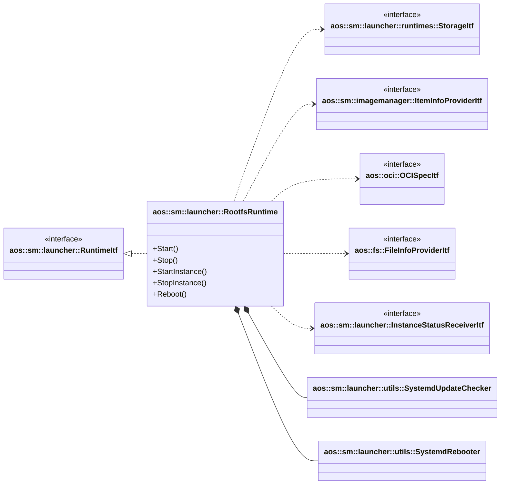
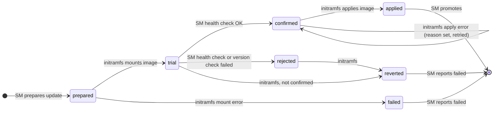
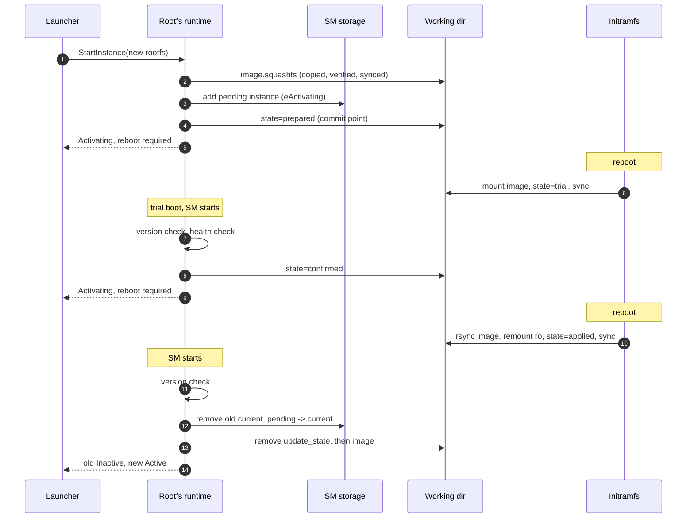
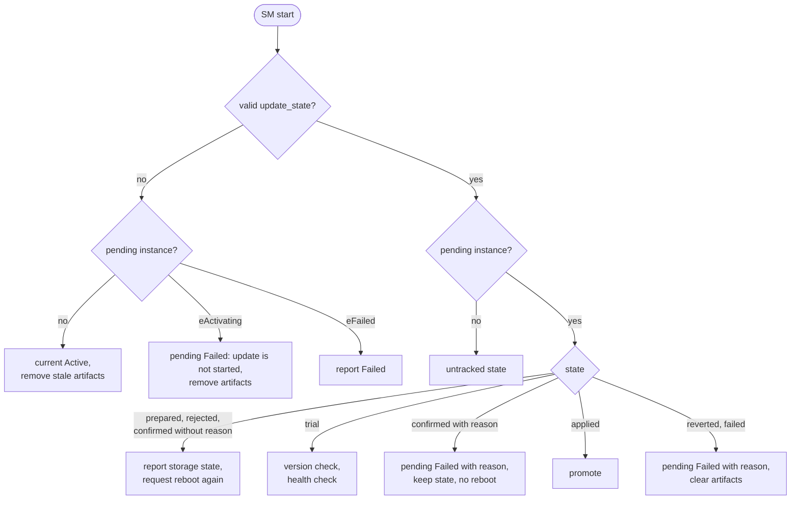

# Rootfs runtime

The rootfs runtime updates the node root filesystem. It is a component runtime with a single instance: the instance
represents the rootfs version that is currently running on the node. Starting a new instance means updating the rootfs.

The update itself is done by the initramfs [aosupdate][aosupdate] module on boot. The runtime prepares the update,
requests reboots, confirms or rejects the updated rootfs with a health check and reports instance statuses.

The update is split between two stores:

- **SM storage** is the source of truth for **which instances exist** and their last reported state and error;
- **update state file** is shared with the initramfs and is the source of truth for **where the update is**.

On start, SM reconciles both stores and continues the update. The update must survive power loss and SM restarts at
any moment. The main rules are:

- a not applied update is never reported as installed;
- a failed update is never applied or promoted;
- SM always starts, even if the update state file is corrupted;
- every step is either atomic or repeatable, and is durable before the next step depends on it.

[aosupdate]: https://github.com/aosedge/meta-aos/blob/develop/recipes-core/initrdscripts/initramfs-framework/aosupdate

## Overview

[RootfsRuntime](rootfs.hpp) implements [aos::sm::launcher::RuntimeItf][runtime-itf] and uses:

- [aos::sm::launcher::runtimes::StorageItf](../itf/storage.hpp) - stores the current and the pending instances;
- [aos::sm::imagemanager::ItemInfoProviderItf][item-info-provider-itf] - provides paths of the installed image blobs;
- [aos::oci::OCISpecItf][oci-spec-itf] - loads the image manifest;
- [aos::fs::FileInfoProviderItf][file-info-provider-itf] - calculates the size and the sha256 hash of the copied image;
- [aos::sm::launcher::InstanceStatusReceiverItf][status-receiver-itf] - receives instance statuses and reboot requests;
- [aos::iamclient::CurrentNodeInfoProviderItf][node-info-provider-itf] - provides node info for the runtime info and the
  default instance ident;
- [SystemdUpdateChecker](../utils/systemdupdatechecker.hpp) - checks that the configured systemd units are active after
  the update;
- [SystemdRebooter](../utils/systemdrebooter.hpp) - reboots the node through systemd.

[runtime-itf]: https://github.com/aosedge/aos_core_lib_cpp/blob/develop/src/core/sm/launcher/itf/runtime.hpp
[item-info-provider-itf]: https://github.com/aosedge/aos_core_lib_cpp/blob/develop/src/core/sm/imagemanager/itf/iteminfoprovider.hpp
[oci-spec-itf]: https://github.com/aosedge/aos_core_lib_cpp/blob/develop/src/core/common/ocispec/itf/ocispec.hpp
[file-info-provider-itf]: https://github.com/aosedge/aos_core_lib_cpp/blob/develop/src/core/common/tools/fs.hpp
[status-receiver-itf]: https://github.com/aosedge/aos_core_lib_cpp/blob/develop/src/core/sm/launcher/itf/instancestatusreceiver.hpp
[node-info-provider-itf]: https://github.com/aosedge/aos_core_lib_cpp/blob/develop/src/core/common/iamclient/itf/currentnodeinfoprovider.hpp



`StopInstance` only reports the instance as inactive: the rootfs can't be stopped. `InitInstances` does nothing and
`GetInstanceMonitoringData` is not supported.

## Configuration

The runtime is configured in the SM `runtimes` section:

```json
{
    "plugin": "rootfs",
    "type": "rootfs",
    "isComponent": true,
    "config": {
        "workingDir": "/var/aos/workdirs/sm/runtimes/rootfs",
        "versionFilePath": "/etc/aos/version",
        "healthCheckServices": ["aos-cm.service", "aos-sm.service", "aos-iam.service"]
    }
}
```

| Parameter             | Default                            | Description                                         |
| --------------------- | ---------------------------------- | --------------------------------------------------- |
| `workingDir`          | `<SM working dir>/runtimes/rootfs` | Update artifacts directory shared with initramfs.   |
| `versionFilePath`     | `/etc/aos/version`                 | Rootfs version file, format: `VERSION="<version>"`. |
| `healthCheckServices` | empty                              | systemd units that must be active after the update. |

`workingDir` must be the directory that the initramfs uses as the update directory (`aosupdate.disk` and
`aosupdate.path` kernel parameters).

## Data

| Data                                                                            | Where            | Written by    |
| ------------------------------------------------------------------------------- | ---------------- | ------------- |
| Current instance: ident, manifestDigest, version, preinstalled, state `eActive` | SM storage       | SM            |
| Pending instance: ident, manifestDigest, version, state, error                  | SM storage       | SM            |
| Update progress: `state`, `type`, `reason`                                      | `update_state`   | SM, initramfs |
| Update image                                                                    | `image.squashfs` | SM            |

### Instances

The runtime instances are stored in the SM storage `runtimeInstances` table, keyed by runtime ID, instance ident
(except the preinstalled flag) and version:

- **current instance** - the installed rootfs, state `eActive`. If it doesn't exist (first start), it is created from
  the version file with the default ident: item ID is the runtime type, subject ID is the node type, the instance is
  preinstalled;
- **pending instance** - the update, state `eActivating` while in progress and `eFailed` with the error after
  failure. The failed pending instance is kept in storage, so the failure is reported after SM restart, until a new
  update replaces it.

The rootfs version file of the update image must contain the version of the update item. The version is used to check
that the node really runs the updated rootfs.

### Working directory

| File             | Written by    | Description                                            |
| ---------------- | ------------- | ------------------------------------------------------ |
| `update_state`   | SM, initramfs | Update state, update type, failure reason.             |
| `image.squashfs` | SM            | Update image copied from the image manager blob.       |
| `*.tmp`          | SM, initramfs | Temporary files of atomic writes, never used as state. |

### Update state file

The file contains one `<key>=<value>` pair per line, so both sides can read and change it with `sed`. The value is the
rest of the line and can't contain line breaks. If a key is repeated, the first line wins.

```text
state=prepared
type=incremental
reason=
```

| Key      | Description                                                                    |
| -------- | ------------------------------------------------------------------------------ |
| `state`  | Update state, see [State machine](#state-machine).                             |
| `type`   | `full` or `incremental`. Missing or unknown type is an error, never defaulted. |
| `reason` | Failure reason, set by SM (health check) or initramfs (mount or apply error).  |

Each change atomically replaces the file: write `update_state.tmp`, sync, rename, sync the directory. A power loss
leaves either the previous or the new state, never a mix of them. Initramfs changes only `state` and `reason` and keeps
other lines as is.

## State machine



| State       | Written by | Initramfs action on boot                                                         |
| ----------- | ---------- | -------------------------------------------------------------------------------- |
| `prepared`  | SM         | mount image (full: as rootfs, incremental: overlay), write `trial`               |
| `trial`     | initramfs  | SM didn't confirm the update: write `reverted` with `update not confirmed`       |
| `confirmed` | SM         | rsync image into rootfs, remount read-only, write `applied`; on error set reason |
| `rejected`  | SM         | write `reverted`, the reason written by SM is kept                               |
| `applied`   | initramfs  | none                                                                             |
| `reverted`  | initramfs  | none                                                                             |
| `failed`    | initramfs  | none                                                                             |

No state file or an unknown state means no update. Trial never modifies the installed rootfs, so a revert only
changes the state. Initramfs doesn't verify the image, it relies on the verification done by SM.

## Update flow

1. SM storage stores the current rootfs instance: itemId, subjectId, instance, manifestDigest, version, preinstalled,
   state `eActive`.
2. On update (`StartInstance` for a new instance):
   1. the running health check is joined, update artifacts are cleared (the state file first) and the previous
      pending instance is removed from storage;
   2. the image is copied to `image.squashfs.tmp`, verified against the layer descriptor (size and sha256 calculated
      by the file info provider), synced and renamed to `image.squashfs`;
   3. SM storage adds the pending instance with state `eActivating`;
   4. `update_state` is created with `state=prepared` and the update type. This is the **commit point**: before it,
      initramfs does nothing;
   5. reboot is requested.
3. Initramfs `aosupdate` is triggered on boot:
   1. `state=prepared`:
      1. mount the update image;
      2. update the state file: `state=trial`;
      3. sync;
      4. continue boot.

      On error: `state=failed` with the reason, boot the installed rootfs.
   2. `state=trial` (SM didn't confirm before reboot): `state=reverted`, `reason=update not confirmed`, sync, boot the
      installed rootfs.
   3. `state=rejected`: `state=reverted` (the SM reason is kept), sync, boot the installed rootfs.
   4. `state=confirmed`: rsync the image into the rootfs, remount it read-only (flushes the rootfs), `state=applied`,
      sync. On error: keep `confirmed`, set the reason, sync. The apply is retried on next boot.
   5. Any other state or no file: no action.
4. SM starts in trial boot (`state=trial`):
   1. the version file must match the pending version, otherwise go to step 4.3 with `rootfs version mismatch`;
   2. health check OK: `state=confirmed`, request reboot. The pending instance stays `eActivating`;
   3. health check failed: `state=rejected` with the reason, pending instance `eFailed` with the error, request reboot.
5. SM starts after apply (`state=applied`):
   1. the version file must match the pending version, otherwise the update is failed (step 6);
   2. the old current instance is removed from storage, then the pending instance becomes current (`eActive`);
   3. remove `update_state` (synced), then the image;
   4. report the old instance as `eInactive` and the new one as `eActive`.
6. SM starts after failure (`state=reverted` or `state=failed`):
   1. pending instance `eFailed` with the reason;
   2. remove `update_state`, then the image;
   3. report the pending instance as `eFailed` and the current one as `eActive`.



If the health check or the version check fails, SM writes `rejected` with the reason, marks the pending instance as
`eFailed` and requests reboot. Initramfs reverts the update on the next boot, SM clears the update artifacts and
reports the failure.

### Start instance

`StartInstance` returns the known status without any action if the instance is the current or the pending one:

- if the pending instance is failed, the update error is returned as well: the launcher treats a successful start as an
  active instance. The failed update is not retried until a new update replaces it;
- if a reboot is still required, the reboot request is sent again. The launcher skips duplicated requests.

Otherwise, the update is prepared (step 2). A new update is accepted in any update state: the state file of the
previous update is removed first, so initramfs doesn't act on it anymore. The media type of the first image layer
defines the update type: `[application/]vnd.aos.image.component.<full|inc>.v<N>[+<suffix>]`.

If any preparation step fails, artifacts and the pending instance are removed and the instance is reported as failed.
If only the reboot request fails, the prepared update is kept, the error is returned and the request is sent again on
the next `StartInstance` for this instance.

### Health check verdict

The health check waits until all configured systemd units are active or any of them failed, with retries (5 attempts,
10 seconds to 1 minute delay). It is started after `Start` sends its statuses, so the health check result is always
received after them.

The verdict is a single state change from `trial` to `confirmed` or `rejected`. An SM restart before the verdict is
stored runs the health check again. If `confirmed` can't be stored, `rejected` is stored instead. In any case the reboot
is requested: the state is either `trial` or `rejected`, which initramfs reverts, or `confirmed` that was renamed but
whose store failed later, which initramfs applies and SM promotes on the next start.

If the pending update is replaced before the verdict is stored, the verdict is discarded.

## Start processing

On start, SM loads the current and pending instances from storage and the update state file, and reconciles them.
Storage and state file lookup errors are returned as errors and are never treated as missing data: a wrong decision
may cancel the update that is being applied.



| `update_state`          | Pending       | Action                                                                  |
| ----------------------- | ------------- | ----------------------------------------------------------------------- |
| none or invalid         | none          | Current `eActive`, remove stale image and temporary files.              |
| none or invalid         | `eActivating` | Interrupted before 2.4: pending `eFailed` with `update is not started`. |
| none or invalid         | `eFailed`     | Report `eFailed`: the failure survives SM restarts.                     |
| `prepared`, `rejected`  | present       | SM restarted before reboot: report storage state, request reboot again. |
| `confirmed` w/o reason  | present       | SM restarted before reboot: report storage state, request reboot again. |
| `trial`                 | present       | Version check and health check (step 4).                                |
| `confirmed` with reason | present       | Apply failed: pending `eFailed` with the reason, state kept, no reboot. |
| `applied`               | present       | Promote (step 5).                                                       |
| `reverted`, `failed`    | present       | Step 6.                                                                 |
| any                     | none          | See [Untracked state](#untracked-state).                                |

Initramfs always changes `prepared`, `confirmed` and `rejected` on boot. These states on SM start mean that SM was
restarted before the reboot, except `confirmed` with the reason, which means that initramfs failed to apply the update.
In this case SM doesn't request reboot to avoid a reboot loop. If SM was interrupted after `rejected` is stored but
before the pending instance is failed, the pending instance is failed on start.

The state file is written atomically, so it is invalid (unknown state) only if the filesystem is damaged. An invalid
state is treated as no update.

If a promotion storage call fails, `Start` returns the error and the promotion is repeated on the next start. If the
old current instance is already removed, there is no current instance in storage. On start, a missing current instance
with the pending instance, `state=applied` and the version file matching the pending version means an interrupted
promotion: the default current instance is not created, the pending instance is promoted. Otherwise, the default current
instance is created from the version file.

### Untracked state

The state file exists, but there is no pending instance: the promotion was interrupted after the storage update
(step 5.2), or storage was lost:

- `confirmed`: the rootfs may be partially updated, cancellation is not safe. The state is kept, initramfs applies the
  update;
- `applied`: the state is removed. If the version file doesn't match the current instance, the current instance is
  restored from the version file with the default ident, and the cloud sends the desired instance again;
- `trial`, `rejected`: the trial rootfs may be running, the state is removed and a reboot is requested, so the
  installed rootfs is booted;
- `prepared`, `reverted`, `failed`: the state is removed.

## Power loss scenarios

| Interrupted at               | State after                       | Result                                           |
| ---------------------------- | --------------------------------- | ------------------------------------------------ |
| 2.2 image copy               | temporary image only              | Temporary image removed, nothing happened.       |
| after 2.3, before 2.4        | pending `eActivating`, no state   | Pending `eFailed`, image removed.                |
| after 2.4, before reboot     | `prepared`                        | SM restart: reboot requested again.              |
| 3.1 before `trial`           | `prepared`                        | Next boot repeats the mount.                     |
| after 3.1, before verdict    | `trial`                           | Next boot: initramfs reverts, update failed.     |
| 4.2 / 4.3 verdict write      | `trial` or the verdict (atomic)   | Revert or the verdict, both consistent.          |
| 4.3 before pending `eFailed` | `rejected`, pending `eActivating` | Pending `eFailed` on SM restart or after revert. |
| 3.2 / 3.3 revert             | `trial` or `rejected`             | Revert repeated on next boot.                    |
| 3.4 during rsync             | `confirmed`                       | Next boot repeats the apply.                     |
| 3.4 after rsync              | `confirmed`                       | Apply repeated, rsync is idempotent.             |
| 5.2 between storage calls    | pending only, `applied`           | Promotion repeated, old instance not reported.   |
| after 5.2, before 5.3        | `applied`, no pending             | Untracked `applied`: state removed.              |
| 5.3 state → image removal    | stale image                       | Image removed on next start.                     |
| 6 storage → state removal    | `reverted` or `failed`            | Step 6 repeated, it is idempotent.               |

## Durability

1. **Each storage call is atomic and durable on return**, no transactions are used. Storage is durable before the state
   file is written (2.3 → 2.4, 4.3, 5.2). The SM database sets `synchronous=FULL`: in WAL mode `synchronous=NORMAL`
   may lose the last commit on power loss, which leaves the state file without the pending instance.
2. **Storage calls are ordered, so every intermediate state is recoverable**:
   - promotion removes the old current instance first, then makes the pending one current. An interruption leaves no
     current instance, which is detected on start and the promotion is repeated. The reverse order may leave two
     current instances that can't be distinguished;
   - restoring the default current instance removes the old one first, then adds the default one. An interruption
     leaves no current instance, and the default one is created on start;
   - preparing an update removes the previous pending instance first, then adds the new one. There is at most one
     pending instance.
3. **Storage and working directory are located on the persistent data partition**, not on the rootfs. During trial
   boot the rootfs is the update image or an overlay: storage on the rootfs is lost on revert or taken from the image.
4. **Ordering rule**: on update, *storage first, state file last* (the state file is the commit point); on cleanup,
   *state file first, then storage and image* (initramfs stops acting first).
5. **Initramfs syncs every state change** before it continues boot.
6. **The image is never removed while the state file exists**: initramfs fails the update without the image.

All files are written atomically: written to `<file>.tmp` (permissions `0600`), fsynced with write and close errors
checked, renamed, and the working directory is fsynced. Artifacts are cleared in two steps:

1. the state file is removed and the working directory is synced. Cleanup stops if this step fails;
2. images and temporary files are removed and the working directory is synced. Errors don't stop the step, the first
   error is returned.

## Reboot requests

Reboots are requested through `InstanceStatusReceiverItf::RebootRequired`. The launcher reboots the node when no launch
is in progress.

While processing the update state, the runtime only sets the reboot required flag. The request is sent by `Start`,
`StartInstance` and the health check thread after the runtime lock is released. If a reboot request fails:

- the error is reported in the instance status;
- the runtime keeps the reboot required flag, and the next `StartInstance` for the current or pending instance sends
  the request again.

A reboot is not requested when initramfs failed to apply the update (to avoid a reboot loop).

## Concurrency

- `mMutex` protects the runtime state. All runtime files and storage records are changed under it.
- The status receiver (statuses and reboot requests) is never called under `mMutex`: the launcher calls the runtime
  under its own lock, so calling the launcher under `mMutex` would create a lock order inversion.
- The health check runs in a separate thread, started by `Start` after its statuses are sent. The thread doesn't hold
  `mMutex` during the check, takes it to store the verdict and requests the reboot after releasing it.
- `mHealthCheckMutex` protects the health check thread object. `JoinHealthCheck` is called without `mMutex`:
  - in `StartInstance` before preparing a new update, so the verdict can't replace the new update state;
  - in `Start` to join the thread of a previous start;
  - in `Stop` and in the destructor: destroying a joinable thread terminates the process.

## Statuses

| Situation                         | Pending instance     | Current instance |
| --------------------------------- | -------------------- | ---------------- |
| no update                         | -                    | Active           |
| update prepared or waiting reboot | Activating           | -                |
| trial boot, health check running  | Activating           | -                |
| update rejected, waiting reboot   | Failed (reason)      | -                |
| initramfs apply failed            | Failed (reason)      | -                |
| update failed or reverted         | Failed (reason)      | Active           |
| failed update after SM restart    | Failed (reason)      | Active           |
| update promoted                   | Active (new current) | Inactive (old)   |

## Design decisions

- The runtime uses its own storage table (`runtimeInstances`), separate from the launcher instances. The runtime
  removes the previous current instance itself on promotion.
- Storage transactions are not used: ordered atomic storage calls are enough to recover every interruption.
- A failed pending instance is kept in storage until a new update replaces it: `StartInstance` for it returns the
  failure without retrying.
- A new update is accepted in any update state, including `trial` and `confirmed`: the previous state file is removed
  first, then the pending instance and the image are replaced.
- Boot ID is not tracked: the update state alone defines the action on start.
- An incremental update after a failed apply is accepted.

## Limitations

- If initramfs doesn't process the update state (e.g. aosupdate module is disabled), every SM start requests a reboot.
- After a failed apply the node boots the partially updated rootfs until the apply succeeds or a new update is applied.
  An incremental update over a partially updated rootfs may leave it inconsistent: a full update is recommended.
- If the verdict can't be stored, the update is reported as failed, but it may still be applied and promoted after the
  reboot.
- If storage is lost during an update, the current instance is restored from the version file with the default ident.
- If the promotion is interrupted after the old current instance is removed, the old instance is not reported as
  `eInactive` on the repeated promotion.
